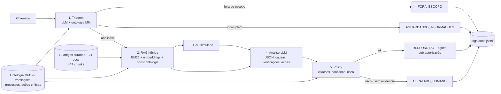

# Assistente Inteligente para Análise de Chamados SAP MM

Protótipo GenAI que interpreta chamados de suporte SAP MM (Procure-to-Pay), identifica o processo, consulta base
de conhecimento (RAG híbrido), apresenta causas e verificações com fontes e nível de confiança, e **encaminha para
validação humana** quando há risco ou evidência insuficiente.

> A IA **recomenda e fundamenta**. Toda ação que altera dados no SAP é apenas descrita e atribuída a um responsável humano.

## Arquitetura



## Execução

```bash
python -m venv .venv && source .venv/bin/activate
pip install -r requirements.txt
cp .env.example .env                 # LLM_PROVIDER=groq e GROQ_API_KEY (ou gemini / ollama)

python scripts/build_ontology.py     # catálogo de transações → data/ontology/
python scripts/ingest_kb.py          # KB + PDFs/DOCX → data/kb_chunks.jsonl
python scripts/build_kb_manifest.py  # inventário → data/kb_manifest.yaml
python scripts/smoke_imports.py

streamlit run app/streamlit_app.py   # interface
python app/cli.py "texto do chamado"
python scripts/run_tickets.py        # 11 chamados → docs/evidence/
```

Provedores (API OpenAI-compatible): **Groq** `openai/gpt-oss-120b` (padrão), Gemini, Ollama. Embeddings locais `paraphrase-multilingual-MiniLM-L12-v2`.

## Estrutura

```
src/assistant/        pipeline: triagem → RAG → análise → policy → auditoria
app/                  streamlit_app.py, cli.py
data/knowledge_base/  KB-MM-001..010 (sintomas → causas → verificações → ação → autorização humana)
data/raw_docs/        documentos de referência (não versionados; ver kb_manifest.yaml)
data/ontology/        mm_ontology.yaml, transacoes_catalogo.yaml
data/tickets/         11 chamados fictícios com resultado esperado
docs/                 decisions.md · risks.md · demo_script.md · evidence/
logs/audit.jsonl      chamado, triagem, fontes, confiança, decisão
```

## Resultados (docs/evidence/run_groq_20261018_200946.md)

| Cenário | Chamados | Resultado |
|---|---|---|
| Sucesso com ação sob autorização humana | T01–T04, T09, T10 | RESPONDIDO, confiança 0.98–0.99, `requer_humano=true` |
| Informação insuficiente | T05, T06 | AGUARDANDO_INFORMACOES com perguntas objetivas |
| Fora de escopo (HR / execução em massa) | T07, T08 | FORA_ESCOPO sem chamada ao LLM de análise |
| Decisão obrigatoriamente humana (customizing) | T11 | ESCALADO_HUMANO mesmo com confiança 0.958 |

[Decisões](docs/decisions.md) · [Riscos e próximos passos](docs/risks.md) · [Roteiro da demo](docs/demo_script.md)
